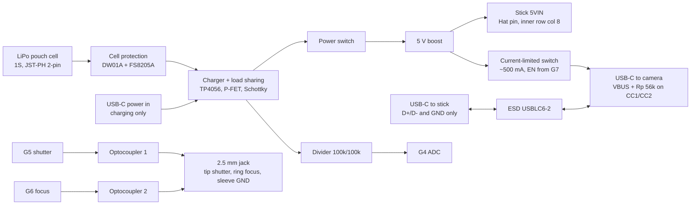

# S3 Hat: power, USB host bridge and trigger board for the M5StickS3

> **PARKED (owner decision, 2026-11-10).** The USB host bridge and battery power are
> dropped for now. The board being built is the jack-only **S3 Jack Hat** in
> [hardware/s3-jack-hat/](../hardware/s3-jack-hat/): the Hat2 header, two optocouplers
> and the 2.5 mm jack, with no battery, charger, USB or boost converter. This document
> and [hardware/s3-hat/](../hardware/s3-hat/) are kept as they were, for when the USB
> host work resumes.

Status: **design draft, nothing built.** The pin map is read from the label printed on
the stick (2026-11-09). Confirm GND and 5VIN with a multimeter before the first board is
ordered.

## Why

On 2026-11-09 we tested the M5StickS3 as a USB host for the camera. A probe firmware
switched the S3's USB port to host mode, and the EOS R never saw it. There were two
causes:

1. **No 5 V on VBUS.** The stick does not drive its USB-C VBUS as a host, and its
   switchable 5 V rail (`M5.Power.setExtOutput`, the Hat/Grove EXT_5V) is not wired to
   the USB-C.
2. **No host announcement on CC.** The stick's USB-C is a sink (Rd). The camera is a
   sink too, and two sinks joined by a C-to-C cable never attach. A phone works because
   it is dual-role.

The stick's own battery is also only 250 mAh.

This board fixes all three and carries the wired trigger, so one stick drives the camera
over USB PTP (full control) and over the remote-release cable (exact bulb timing).

## Block diagram

## Pin map (Hat2-Bus, 2x8, as printed on the stick)

| Column | 1 | 2 | 3 | 4 | 5 | 6 | 7 | 8 |
| --- | --- | --- | --- | --- | --- | --- | --- | --- |
| Edge row | G5 | G4 | G6 | G7 | G43 | G44 | G2 | G3 |
| Inner row | GND | EXT_5V | G0 | G1 | G8 | BAT | 3V3_L2 | 5VIN |

| Signal | Pin | Why this pin |
| --- | --- | --- |
| Shutter | G5 | Not a strapping pin |
| Focus | G6 | Not a strapping pin |
| Camera VBUS enable | G7 | Lets firmware cut camera-port power when idle |
| Battery voltage | G4 | ADC1 channel; safe with Wi-Fi off or on |
| Board 5 V into the stick | 5VIN | The only Hat pin specified as a 5 V input |
| Ground | GND | |
| Not used | G0, G3 | 🔴 Boot strapping. An optocoupler LED on G0 pulls it low at reset, and the chip boots into download mode |
| Not used | G43, G44 | UART0, which carries the boot log |
| Not used | EXT_5V | The stick's own 5 V rail. 🔴 Never feed it from outside while it is in output mode (retailer spec) |
| Spare | G1, G2, G8 | Spare: a status LED, or a second camera later |

Since firmware 0.35.0 / app 0.651.0 the StickS3 defaults to shutter G5 and focus G6
(`firmware/include/config.h`, `AppConfig.kt`), and G0/G3 are no longer offered. A Stick or
phone that still holds the prototype's G0 is moved to G5/G6 on its own: the firmware rejects
the saved pin at boot, and the app replaces it on the next connect.

## USB

- **Stick side:** a USB-C receptacle wired to D+, D− and GND only. The stick is powered
  through 5VIN, so it never gets 5 V from two places. A short C-to-C cable runs to the
  stick's own USB-C (S3 G19 = D−, G20 = D+).
- **Camera side:** a USB-C receptacle with 56 kΩ Rp on CC1 and CC2 to its VBUS. That
  announces a default-power source, so the camera attaches. VBUS comes through a
  current-limited switch (~500 mA), enabled by G7.
- **ESD:** a USBLC6-2SC6 on D+/D− at the camera connector.
- D+/D− are a 90 Ω differential pair, short and straight.
- **No hub.** The S3's USB host library (ESP-IDF 4.4 in Arduino core 2.0.17) has no hub
  support.

## Power

- **Cell:** a 1S LiPo pouch on a JST-PH 2-pin connector. The size is set by the case;
  a 2000 mAh cell is about 50 × 34 × 6 mm.
- **Protection:** a DW01A plus FS8205A on the board, even if the cell carries its own
  protection circuit.
- **Charging:** a TP4056 at ~500 mA (set by its PROG resistor) from a USB-C power-in
  socket (5.1 kΩ Rd on CC). A P-FET plus Schottky load-sharing circuit means the board
  runs from USB while charging, instead of loading the charger.
- **Boost:** a TPS61023, giving 5 V at 1.5 A from one Li-ion cell. Its PFM mode keeps it
  efficient at the ~150 mA we expect. JLC has **no** Basic boost converter (the MT3608 is
  Extended too), so the better part costs no extra fee. The trade-off is a small
  SOT-563 package, which JLC places.
- **Power switch:** a slide switch between the protection and the boost converter.
  Without it the board drains the cell, because the stick's 5VIN keeps it alive.
- **Budget (estimate, to be measured):** the stick with BLE and the display off draws
  ~60–100 mA at 5 V. The camera's USB side draws about 10–50 mA, depending on the body.
  Boost efficiency is ~85–90 %. That gives ~150 mA average at 5 V, so roughly
  9 h on a 2000 mAh cell and 13 h on 3000 mAh.
- **The camera keeps its own battery** (decided). USB-PD to power the body is out of
  scope; use a DR-E6 (R) / DR-E18 (RP) dummy battery for long nights.

## Trigger

- One SMD optocoupler per line (EL817S / LTV-817S class).
- The LED runs from the GPIO through 330 Ω, ~5–6 mA at 3.3 V. That is enough for a
  CTR ≥ 50 % part to sink the camera's few-mA remote line.
- The transistor's collector goes to the line and its emitter to the jack's sleeve
  (camera ground). The camera stays isolated from the stick.
- 2.5 mm stereo jack: tip = shutter, ring = focus, sleeve = ground (Canon E3, R and RP).
- A pull-down on each GPIO side (100 kΩ), so the optocouplers stay off while the S3
  boots.

## Parts (JLCPCB / LCSC, checked 2026-11-09)

Numbers, library types and stock come from JLCPCB's parts search, checked live on
2026-11-09. Stock and prices change daily, so recheck before ordering. "Basic" and
"Preferred" parts carry no feeder fee on Economic PCBA.

| Function | Part | LCSC | JLC type | Notes |
| --- | --- | --- | --- | --- |
| Charger | TP4056-42-ESOP8 | C16581 | Preferred | PROG 2.4 kΩ (C22940, Basic) gives ~500 mA (I = 1200 / R) |
| Cell protection | DW01A | C351410 | Extended | 4.3 V over / 2.5 V under |
| Protection FETs | FS8205A | C2830320 | Extended | dual N-FET |
| Load-sharing FET | AO3401A | C15127 | Basic | P-channel |
| Load-sharing diode | B5819W SL | C8598 | Basic | 1 A Schottky, SOD-123 |
| Boost | TPS61023DRLR | C919459 | Extended | 5 V 1.5 A, PFM at light load |
| Boost inductor | FNR4030S1R0MT, 1 µH | C167865 | Extended | I_sat 5.26 A rated (5.7 typ), I_rms 4.15 A, 18 mΩ; checked 2026-11-09 |
| Camera VBUS switch | SY6280AAC | C55136 | Extended | EN from G7; R_SET 13 kΩ (C22797, Basic) gives ~520 mA (I = 6800 / R; 0.4 A min) |
| USB ESD | USBLC6-2SC6 (UMW) | C2687116 | Extended | pin-compatible with ST's |
| USB-C, data ×2 | TYPE-C 16PIN 2MD(073) | C2765186 | Extended | stick side + camera side; one feeder for both |
| USB-C, charge in | TYPE-C 6P | C456012 | Extended | power only; 5.1 kΩ Rd (C23186, Basic) |
| Optocoupler ×2 | LTV-817S-TA1-C | C109227 | Basic | CTR 200–400 % |
| 2.5 mm jack | PJ-242 | C431536 | Extended | SMD, 4-contact; tip 6, ring 4, sleeve 2+3 (read from the drawing 2026-11-09) |
| Battery connector | PH-2AWT (JST-PH compatible) | C2763693 | Extended | SMD right-angle |
| Power switch | SS-12D10L5 | C319012 | Extended | 3 A SPDT; through-hole, hand-soldered |
| Hat header | 2×8 male 2.54 mm | C68234 (straight) / C54907672 (right-angle) | Extended | choose with the enclosure; the stick's header is reportedly female, check |
| Resistors | 56 kΩ Rp ×2 | C23206 | Basic | |
| | 330 Ω LED ×2 | C23138 | Basic | |
| | 100 kΩ divider / pull-downs | C25803 | Basic | picked 2026-11-09 for the schematic |

The schematic added more passives. Their parts are listed under "Schematic decisions"
below.

Fees, per JLCPCB's pricing page: the Economic PCBA setup is about $8, the stencil about
$1.5, and each unique Extended part about $3 (sources disagree after a 2025-12 change, so
check at checkout). With about 12 Extended parts that comes to roughly $37 in fees per
order, plus hand-soldering for the through-hole switch (and the header).

## Schematic decisions (2026-11-09)

The KiCad 10 schematic is in [hardware/s3-hat/](../hardware/s3-hat/). It is a schematic
only: it has not been laid out or built. ERC gives 0 errors. The 3 warnings are the three
parts that have no footprint yet. `tools/check_netlist.py` checks the key connections
against the exported netlist and passes.

**Values chosen.** Every LCSC number below was looked up in JLCPCB's parts search on
2026-11-09.

| Where | Value | LCSC | JLC type | Why |
| --- | --- | --- | --- | --- |
| TPS61023 feedback | R1 220 kΩ / R2 30 kΩ | C22961 / C22984 | Basic | V_REF is 0.595 V typ. in PWM and 0.601 V in PFM (TI SLVSF14B, Electrical Characteristics). That sets 4.96 V in PWM and 5.01 V in PFM. TI's own 732k/100k pair is Extended. R2 stays below TI's 300 kΩ limit. |
| TPS61023 in / out | 10 µF / 2 × 22 µF, 0805 25 V X5R | C15850 / C45783 | Basic | TI figure 8-1 (Li-ion to 5 V) |
| TP4056 VCC, BAT | 10 µF 0805 25 V | C15850 | Basic | The datasheet's typical circuits |
| SY6280 IN, OUT | 10 µF 0805 25 V | C15850 | Basic | The datasheet asks for 10 µF at IN for hot-plug, and its example shows 10 µF at OUT |
| DW01A | 100 Ω, 100 nF, 1 kΩ | C22775, C14663, C21190 | Basic | The PUOLOP DW01A typical application circuit. TD (pin 4) is left open |
| Charge LEDs | red 0603 + 1 kΩ (CHRG), green **0805** + 1 kΩ (STDBY) | C2286, C2297, C21190 | Basic | The Basic 0603 green, C72043, is now Extended and out of stock |
| Camera USB-C shield | 1 MΩ ∥ 4.7 nF to GND | C22935, C53987 | Basic | A common choice: no DC ground loop through the camera cable shield. The stick-side and power-in shields go straight to GND |
| Load-share gate pull-down | 100 kΩ | C25803 | Basic | |

**Charge current.** The TP4056 datasheet gives I_BAT = 1100 × V_PROG / R_PROG with
V_PROG = 1 V. With 2.4 kΩ that is about **460 mA**. The datasheet's own table puts it
between 400 mA (3 kΩ) and 580 mA (2 kΩ). The "1200 / R ≈ 500 mA" figure in the parts table
is a little high.

**Stick-side CC pins are left open.** With no Rp, the stick never sees a source, so it never
expects VBUS from this port. With no Rd, the board does not pretend to be a sink either.
On a passive C-to-C cable, USB 2.0 data does not depend on CC. VBUS is open, because the
stick gets its power from 5V0 through the Hat 5V_IN pin.

**Spare GPIOs.** G1, G2 and G8 go to J7, an unpopulated 1×4 2.54 mm hole pattern (G1, G2,
G8, GND). It costs board area only. EXT_5V, G0, G3, G43, G44, BAT and 3V3_L2 carry
no-connect flags.

**Battery divider.** It hangs on the cell + (VBAT), ahead of the switch. It draws about
21 µA all the time, so it takes years to drain 3000 mAh. With the switch on and USB
present, G4 still reads the cell, not the USB rail.

**PJ-242 pin roles.** These were read from the Shou Han drawing (datasheet linked from
C431536, rev A2, 2022-06-22). The plug drawing numbers the contact zones 2, 3, 4 and 6,
counting from the jack face. The internal schematic shows switch contacts 7 (on 6) and
5 (on 4). The schematic therefore uses:

- **6 = tip** (shutter);
- **4 = ring** (focus);
- **2 = sleeve.** Pin 3 is tied to the sleeve as well. It touches the sleeve zone of a
  3-pole plug, and the drawing would also take a 4-pole plug.
- 5 and 7 are the normally-closed switch contacts, left open.

Re-read 2026-11-09, and it holds: the jack is a **4-contact** part. The plug drawing
puts zone 2 at 0–2.4 mm from the face, zone 3 at about 2.4–4.1 mm, zone 4 at 4.8–6.5 mm,
and zone 6 (the tip) from 6.5 to 11.2 mm. On a 3-pole plug like Canon's the sleeve
covers zones 2 and 3, so tying them is right. Confirm on the first board with a real
Canon remote cable: tip fires the shutter, ring focuses. The Canon plug's ring position is
not dimensioned against this drawing.

🔴 **Unconfirmed.** Check these with a meter and a Canon E3 plug before layout.

**Pin facts checked against datasheets:**

| Part | Pins | Source |
| --- | --- | --- |
| TPS61023 DRL | 1 FB, 2 EN, 3 VIN, 4 GND, 5 SW, 6 VOUT | TI SLVSF14B section 5 |
| SY6280AAC | 1 OUT, 2 GND, 3 ISET, 4 EN, 5 IN; I_lim = 6800 / R_SET | Silergy datasheet |
| DW01A | 1 OD, 2 VM/CS, 3 OC, 4 TD, 5 VCC, 6 GND | PUOLOP datasheet |
| USBLC6-2SC6 (UMW) | 1/6 I/O1, 2 GND, 3/4 I/O2, 5 VBUS | UMW datasheet |
| TP4056 | 1 TEMP (grounded disables the NTC), 2 PROG, 3 GND, 4 VCC, 5 BAT, 6 STDBY, 7 CHRG, 8 CE | TOPPOWER datasheet |
| TYPE-C 16PIN 2MD(073) | standard A1–A12 / B1–B12 assignment | Shou Han drawing |
| TYPE-C 6P | A5 CC1, A9/B9 VBUS, A12/B12 GND, B5 CC2 | Shou Han drawing |

**Verified 2026-11-09:**

- **FNR4030S1R0MT (C167865): saturation 5.26 A rated, 5.70 A typical; heat rating
  4.15 A rated, 4.70 A typical; DCR 18 mΩ max.** Read from the CJiang FNR series
  datasheet, FNR4030S table. JLC's "4.7 A / 5.7 A" were the two *typical* values,
  I_rms and I_sat. At the TPS61023's current limit the inductor peak is about 4.9 A
  (a 3.7 A valley limit plus ~1.2 A ripple at 3.0 V in, 1 µH, ~1 MHz), under the rated
  5.26 A. At a 1 A load it is ~2.5 A. The datasheet lists the 1 µH part as ±30 % ("NT");
  JLC sells "MT" (±20 %), the same part with a tighter tolerance code.

- **FS8205A pin numbers: 1 S1, 2 D, 3 S2, 4 G2, 5 D, 6 G1.** Read from the Tech Public
  datasheet for C2830320 ("Package and Pin Configuration", page 1). The row by the pin-1
  dot reads S1, D1/D2, S2; the opposite row reads G2, D1/D2, G1, counted back the other
  way as for any SOT-23-6. This matches the schematic. 🔴 Other vendors' SOT-23-6
  "FS8205A" parts do not promise the same pinout, so **never substitute C2830320** at
  ordering without checking the new part's drawing.

**Still unverified:**

- **AO3401A pins** (1 G, 2 S, 3 D). These come from KiCad's symbol, because the LCSC
  datasheet link returned an HTML page.
- **22 µF 0805 at 5 V.** DC-bias derating leaves maybe half the nominal value. Check the
  TPS61023 loop against TI's minimum effective C_out.
- **Hat header orientation.** With the stick lying flat on a right-angle header, its rows
  may come out mirrored. Check pin 1 before layout.

**Footprints.**

- Custom footprints are needed for:
  - J1, the TYPE-C 6P. KiCad has no stock match.
  - SW1, the SS-12D10L5: 4.7 mm pitch, 0.8 mm pins.
  - J6, the PJ-242.
- Candidate stock footprints, to compare against the drawings:
  - J3/J4: HRO TYPE-C-31-M-12. The pad pitch, the pegs (5.78 mm) and the slot positions
    (8.64 mm, 4.18 mm) match. The rear slots in the Shou Han drawing are 1.40 mm drill /
    1.80 mm pad, against 1.2 / 1.6 in the HRO footprint, so make a corrected copy.
  - J2, the PH-2AWT: JST S2B-PH-SM4-TB.
  - U1: the SOIC-8-1EP thermal-pad size.
  - U3: KiCad's SOT-563 against TI's DRL land pattern.
- Stock footprints taken as-is: SOT-23/-5/-6, SOD-123, 0603/0805, FNR4030S, SMDIP-4
  W9.53 mm and the 2×8 right-angle header.

## Open questions

1. **Power-off behaviour.** Does the stick power off (double-press) while 5VIN is fed?
   If not, the board's slide switch is the only off switch. Test it on the first board.
2. **Camera VBUS draw.** Measure what the R and RP actually draw from VBUS, then size
   the limit resistor.
3. **Enclosure.** Board outline and cell size depend on whether it clips onto the stick
   or sits in a box beside it.
4. **Cable direction.** The stick's USB-C is at the far end from the Hat, so the C-to-C
   link is a short loop. A right-angle cable keeps it tidy.

## How it gets verified

1. Probe firmware (scratch, `ptp-probe`): press A and the screen must show
   "Canon EOS R" and its operations. That proves VBUS, CC and data.
2. The wired trigger: the existing Pulsar BLE modes on G5/G6.
3. Battery: current at the cell measured idle, during a BLE run and during a PTP run.
   Runtime is then computed from measurement, not from the estimate above.
