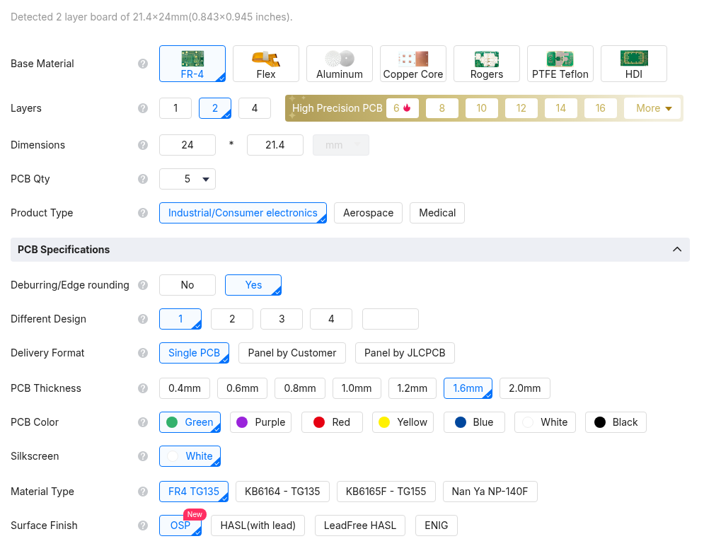
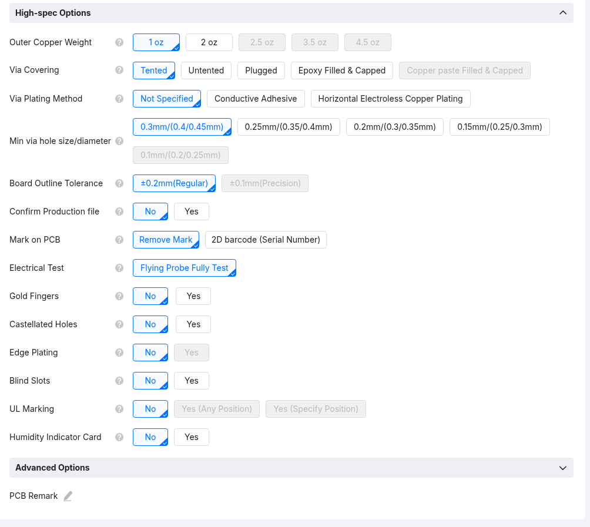
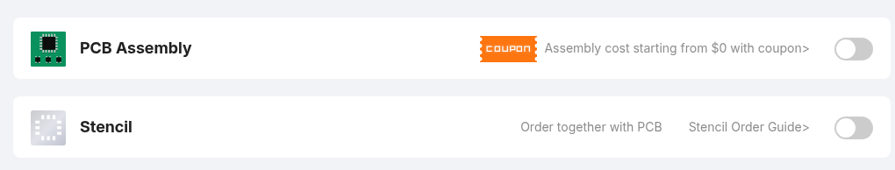
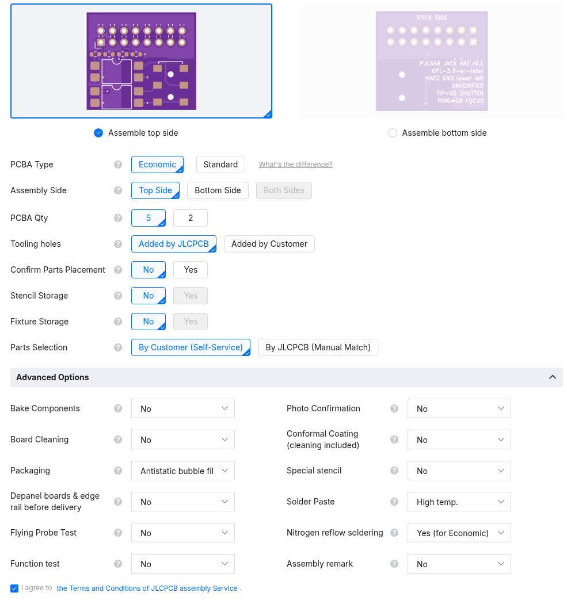
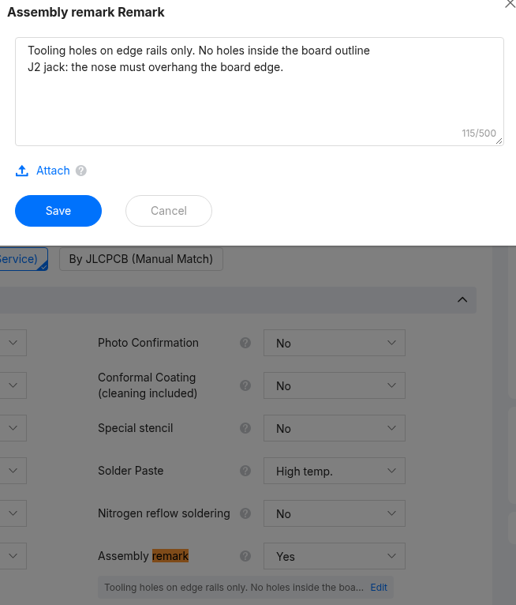
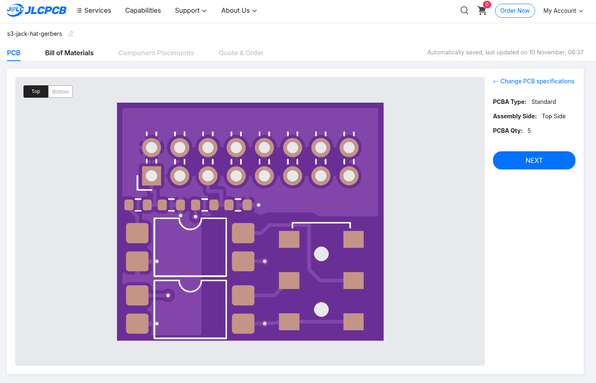
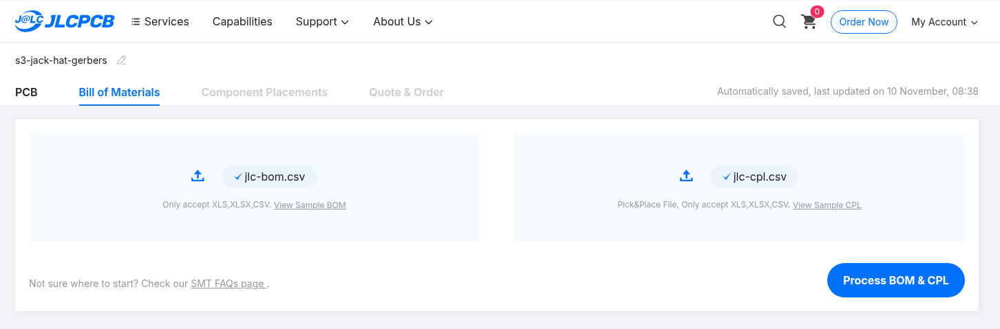
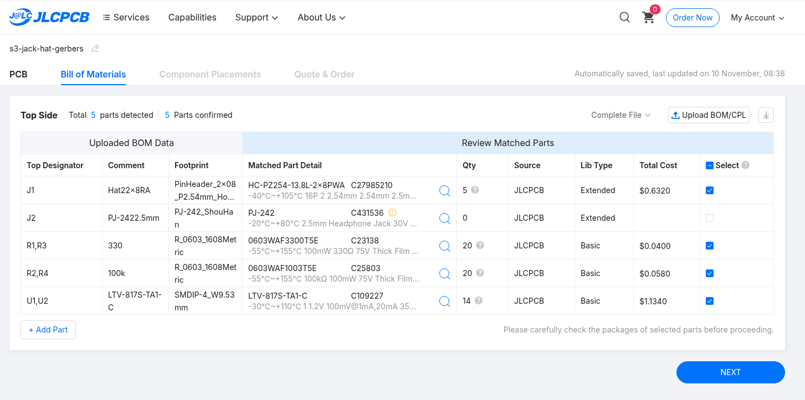
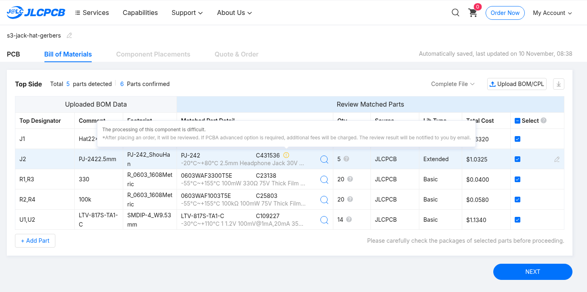

<!--
SPDX-License-Identifier: GPL-3.0-or-later
Copyright (C) 2026 Pulsar Trigger contributors
-->

# Ordering the S3 Jack Hat and its case

Two orders, both at JLC on the same account:

| What | Where | Files |
| --- | --- | --- |
| The board, made and assembled | [jlcpcb.com](https://jlcpcb.com) | `out/s3-jack-hat-gerbers.zip`, `out/jlc-bom.csv`, `out/jlc-cpl.csv` |
| The case, 3D printed | [jlc3dp.com](https://jlc3dp.com) | `case/out/base.stl`, `case/out/lid.stl` |

You also need three screws, which JLC does not supply: 2 × M2 × 8 and 1 × M2 × 6,
flat head (countersunk).

Ignore `out/s3-jack-hat-pos.csv`. It is KiCad's raw placement file; `jlc-cpl.csv` is the
same data in the format JLC asks for.

The screenshots were taken on 2026-11-10. JLC changes its pages from time to time, so the
layout may differ; the choices still apply.

## The board

### 1. Upload the gerbers and set the board options

Upload `out/s3-jack-hat-gerbers.zip`. JLC should report a **2 layer board of
21.4 × 24 mm**.



| Option | Choose | Why |
| --- | --- | --- |
| Base material | FR-4 | |
| Layers | 2 | |
| PCB thickness | **1.6 mm** | The case's hat bay is 1.6 deep, the board thickness |
| Quantity | 5 (the minimum) | |
| Delivery format | Single PCB | |
| Colour | Any | Looks only |
| Surface finish | **LeadFree HASL** or ENIG, not OSP | OSP degrades within months and takes rework poorly. ENIG gives flatter pads |
| Deburring / edge rounding | Either | A few cents; the board does not need it |

The screenshot still shows OSP; change it.

### 2. High-spec options: leave the defaults



- **Min via hole size: 0.3 mm**, the default. The board's 8 vias are 0.3 mm holes in
  0.6 mm pads.
- **Mark on PCB: Remove Mark.** The board has no free space for JLC's order number.
- Everything else at its default: 1 oz copper, tented vias, ±0.2 mm outline, flying
  probe test, no gold fingers or castellated holes.

### 3. Turn on PCB Assembly



Turn **PCB Assembly** on. Leave **Stencil** off; JLC uses its own when it assembles.

### 4. Assembly options



| Option | Choose | Why |
| --- | --- | --- |
| Side | **Assemble top side** | All parts are on the top |
| PCBA type | **Standard** (the screenshot still shows Economic) | The 2 × 8 header is a through-hole part; Economic does not solder those |
| PCBA quantity | 2 or 5 | 2 is cheaper |
| Tooling holes | Added by JLCPCB, plus the remark below | |
| Confirm parts placement | **Yes** | An engineer sends the placement for approval before soldering. The jack and the optocouplers are the parts most likely to be rotated wrong |
| Parts selection | By Customer | The BOM carries every LCSC part number |
| Advanced options | Defaults | |

The bottom-side preview is all silkscreen text ("PULSAR JACK HAT r0.1",
"TIP=G5 SHUTTER", "RING=G6 FOCUS"). That is expected: there are no parts on it.

### 5. Assembly remark



Set **Assembly remark** to Yes and write:

```text
Tooling holes on edge rails only. No holes inside the board outline
J2 jack: the nose must overhang the board edge.
```

There is no room on the board for a tooling hole; one drilled through a trace ruins it.

### 6. Board preview



Check the summary on the right: **Standard, Top Side**, and your quantity. The top shows
the 16 header pads along one edge, the four resistors below them, the two optocouplers
on the left and the jack's pads and two locating holes on the right.

### 7. Upload the BOM and the placement file



Upload `out/jlc-bom.csv` on the left and `out/jlc-cpl.csv` on the right, then
**Process BOM & CPL**.

### 8. Parts list

JLC matches each BOM line to a part. Check that all five lines show the part numbers from
the BOM. The quantities (20, 14) are higher than the board needs; JLC orders spares to
cover machine losses.



🔴 **The jack (J2) arrives unticked**, with a yellow ⚠ and quantity 0. Tick its
**Select** box. Without it the board has no connection to the camera.



The ⚠ means JLC rates the jack hard to assemble: it reviews it after the order and emails
if an advanced option, at extra cost, is needed. Expect that email.

### 9. Component placements

*(to be added)*

## The case

*(to be added: jlc3dp.com, MJF, PA12, one of each part)*
