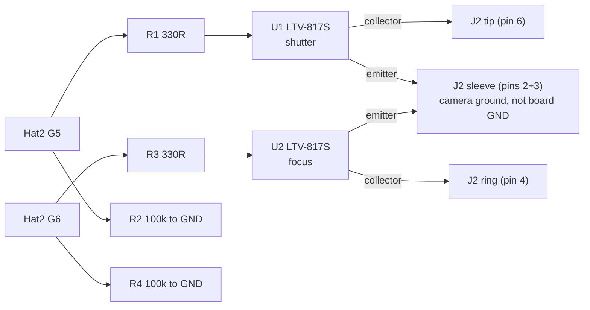

<!--
SPDX-License-Identifier: GPL-3.0-or-later
Copyright (C) 2026 Pulsar Trigger contributors
-->

# S3 Jack Hat (KiCad 10)

Source: written for Pulsar.

**Status: r0.1 built (JLC, 2026-11) and its header is mirrored end to end - it does not
work as shipped. Rework below; r0.2 = regenerate from the fixed
[tools/hat2.py](tools/hat2.py) with `tools/build.sh` before ordering again.** The files in
`out/` and the `.kicad_pcb` are still r0.1. The PJ-242 pin roles are read from the
maker's drawing, not yet measured.

## 🔴 r0.1: header mirrored end to end (found 2026-11-24)

Plugged in with its components towards the stick's back (the only way the case takes it),
r0.1's square pad 1 sits at the **G3 / 5V_IN** end of the socket, not the G5 / GND end:

| r0.1 net | Pad | Meant for | Lands on (normal) | Lands on (upside down) |
| --- | --- | --- | --- | --- |
| Shutter (R1, U1) | 1 | G5 | G3 | the stick's GND (can never fire) |
| Board GND | 2 | GND | **5V_IN** | G5 |
| Focus (R3, U2) | 5 | G6 | G44 (UART TX) | **G0** (boot strap) |

So nothing fires the normal way. Upside down, focus follows G5 and G0, and G0 is tied to
the focus net, which can boot the stick into download mode. Use it neither way unrepaired.

**Rework (three wires, three pins):**

1. Clip or pull the header pins of **pads 1, 2 and 5** so they no longer enter the socket.
   Pad 2 is the one that matters: left in, it shorts 5V_IN to ground once step 2 is done.
2. Wire, on the board: **pad 1 → pad 15** (lands on G5), **pad 2 → pad 16** (GND),
   **pad 5 → pad 11** (G6). Pads 11, 15 and 16 are unconnected on r0.1.
3. Before power, plugged in normally: board GND to the stick's USB-C shell **beeps**;
   board GND to 5V_IN does **not**; the jack sleeve to board GND stays **open**.
4. Dry run with a plug: focus closes ring-sleeve, shutter closes tip-sleeve.

**Cause:** `GND_CORNER`'s side. The row was right, the end was not; the stick's label
reading below still holds for which row, and `("lower", "right")` is what the footprint
needs. With that value `hat2.py` maps G5 → pad 15, GND → pad 16, G6 → pad 11 - exactly
where the rework puts them.

This is a small board that plugs into the M5StickS3's Hat2-Bus and drives a Canon 2.5 mm
remote jack:

- G5 drives the shutter and G6 drives focus.
- Each line goes through an LTV-817S optocoupler, so the camera stays isolated from the
  stick.
- The board has no battery, charger, USB or boost converter. The stick runs on its own
  battery, or on a power bank plugged into its USB-C.

The larger hat (USB host bridge and LiPo power) is parked. It is in
[docs/hardware-s3-hat.md](../../docs/hardware-s3-hat.md) and [../s3-hat/](../s3-hat/).



## 🔴 Unverified before ordering

1. ~~**Header orientation.**~~ **Settled 2026-11-10, WRONG END - fixed 2026-11-24 to
   `("lower", "right")`, see "r0.1: header mirrored" above.** It read: `GND_CORNER = ("lower", "left")`
   in [tools/hat2.py](tools/hat2.py). GND is in the row nearer the stick's back, at the
   LED end of the socket. Four sources agree: the stick's back sticker, whose label lines
   are laid out like the rows, and Bruce firmware's CC1101, SD card and NRF24 wiring
   diagrams for the StickS3. The first guess, `("upper", "left")`, was wrong: it would
   have swapped every pin pair and put the focus line on G0, the boot strap pin.
2. **PJ-242 pin roles.** The pins were read from the maker's drawing: 6 = tip, 4 = ring,
   2 + 3 = sleeve, 5/7 = switch contacts. See "PJ-242 pin roles" in the parked spec.
   Check them with a meter and a Canon plug.

## Hat2-Bus pin map (source checked)

Two sources give the same map:

- **M5Stack's StickS3 docs PDF, page 10, "Hat2-Bus".** It lists the LEFT column as pins 1, 3, … 15 and the
  RIGHT column as pins 2, 4, … 16.
- **The stick's schematic, page 4 (the BTB small board, CN2, "2×8 female, plastic height
  8.5, P = 2.54").** It numbers the same socket the other way: pins 1–8 down one row and
  16–9 back up the other. The pairs across the socket (GND/G5, EXT_5V/G4, BOOT/G6, G1/G7,
  G8/G43, BAT/G44, 3V3/G2, 5V_IN/G3) are identical, so the two numberings describe the
  same socket.

This board uses M5's odd/even numbers.

| Column | 1 | 2 | 3 | 4 | 5 | 6 | 7 | 8 |
| --- | --- | --- | --- | --- | --- | --- | --- | --- |
| Odd pin (1–15) | GND | EXT_5V | G0 (Boot) | G1 | G8 | BAT | 3V3_L2 | 5V_IN |
| Even pin (2–16) | G5 | G4 | G6 | G7 | G43 | G44 | G2 | G3 |

**G5 and G6 are free.** In the stick's schematic, EXT_GPIO5/6 run only from the ESP32-S3
(GPIO5/GPIO6, pins 10/11) through the board-to-board connectors to the Hat socket. They
have no other load, pull or function. G0 and G3 are boot-strapping pins and are left
unconnected. Every pin except GND, G5 and G6 carries a no-connect flag.

## Files

| Path | What |
| --- | --- |
| `s3-jack-hat.kicad_pro`, `.kicad_sch`, `.kicad_pcb` | The project. The board is saved with its zones filled |
| `s3-jack-hat.kicad_dru` | Custom rule: the camera side (jack nets) keeps ≥ 1 mm from everything else |
| `s3-jack-hat.kicad_sym`, `s3-jack-hat.pretty/` | The PJ-242 symbol and footprint (generated) |
| `tools/hat2.py` | **The one orientation choice** (`GND_CORNER`) and the Hat2 map |
| `tools/gen_schematic.py` | Writes the schematic. Its symbol engine is copied from `../s3-hat/tools/` |
| `tools/gen_pcb.py` | Writes the PJ-242 footprint and the board from the exported netlist |
| `tools/check_netlist.py` | Asserts every required connection, and every unconnected pin |
| `tools/jlc_files.py` | Writes the JLC BOM and CPL |
| `tools/build.sh` | Runs everything above, then exports the fabrication files |
| `out/` | ERC/DRC reports, netlist, Gerbers + drill (folder and zip), BOM, CPL, schematic PDF, renders |

**Edit the scripts, not the KiCad files.** The next build overwrites any hand edit.

## Regenerate and check

```sh
hardware/s3-jack-hat/tools/build.sh     # exit 0 = everything below passed
```

The script stops at the first failure. It runs:

1. the footprint;
2. the schematic;
3. ERC (`--exit-code-violations`, so any warning fails too);
4. the netlist export and `check_netlist.py`;
5. the board;
6. DRC with zone refill and schematic parity. It fails on any error, or on any warning
   other than the one expected below;
7. the Gerbers, drill files, position file, JLC CSVs, schematic PDF and renders.

**Results on 2026-11-10:**

- **ERC:** 0 violations.
- **Netlist check:** all 48 checks pass (exit 0). Verified that it can fail: a netlist
  with the sleeve merged into GND fails it (exit 1).
- **DRC:** 0 errors, 0 unconnected, 0 schematic-parity issues, and 1 warning. The warning
  is `lib_footprint_mismatch` on J1, because the generator drops the header's silkscreen
  where it would hang over the board edge.
- **The isolation rule fires.** A test GND via placed 0.6 mm from the tip pad was flagged:
  "rule 'camera side isolation' clearance 1.0000 mm; actual 0.6000 mm". The default
  0.2 mm rule would have passed it.

The 3D renders show only the bare board. This KiCad install has no 3D models, so no part
bodies are drawn.

## BOM (JLC parts checked 2026-11-10 through JLC's parts API)

| Ref | Part | LCSC | JLC type | Stock 11-10 | Notes |
| --- | --- | --- | --- | --- | --- |
| J1 | Hong Cheng HC-PZ254-13.8L-2x8PWA, 2×8 right-angle male, 2.54 mm | C27985210 | Extended | 1381 | Through-hole: needs JLC's THT assembly, or hand soldering. It was chosen over C54907672 because it has a drawing (2.5 mm insulator, 6.0 mm mating pin, 3.0 mm tail, Ø1.02 holes) |
| J2 | Shou Han PJ-242, 2.5 mm SMD jack | C431536 | Extended | 16411 | Footprint drawn from the maker's land pattern |
| U1, U2 | Lite-On LTV-817S-TA1-C | C109227 | Basic | 382366 | SMD-4 |
| R1, R3 | 330 Ω 0603 1 % (0603WAF3300T5E) | C23138 | Basic | 2735562 | ~5–6 mA LED current at 3.3 V |
| R2, R4 | 100 kΩ 0603 1 % (0603WAF1003T5E) | C25803 | Basic | 15778519 | Keep the LEDs off while the S3 boots |

**Alternate header: C54907672,** the Shou Han PZ2.54-2x8PWZ-L18.8-A (Extended, 748 in
stock). JLC lists the same attributes for it (2.5 mm insulator, 6 mm mating pin, 3 mm
tail), but there is no drawing. Its "L18.8" suffix is 5 mm longer than Hong Cheng's
"L13.8", so check its pin length before you substitute it.

**JLC rotation.** The CPL carries KiCad's rotations. JLC's library orientation differs
for some parts, most likely the SMDIP-4 and the PJ-242. Check every part in JLC's
placement preview before you pay.

## Mechanics: numbers for the case

**Board frame.** The stick lies screen up, with its Hat end touching the board.

- **u** runs across the board, west to east, as seen from above with the stick at the
  top of the view. u = 0 is the board's left edge.
- **v** runs away from the stick. v = 0 is the edge that touches the stick's end face.
- **Z** is height. Z = 0 is the board's top surface, which is level with the stick's back.

| Item | Value |
| --- | --- |
| Board | **24.0 × 21.4 mm**, 1.6 mm FR4, square corners, 2 layers. Z −1.6 to 0, so the case floor under the hat sits 1.6 mm below the stick's back |
| Header pin columns | 8 columns at u = 3.11 + 2.54·(k−1), so 3.11 to 20.89, centred on u = 12.0 (the socket is centred across the stick) |
| Header pads in the board | lower row (pads 2–16) at v = 4.04; upper row (pads 1–15) at v = 6.58 |
| Header plastic body | on the board, v = 0 to 2.54, u ≈ 1.84 to 22.16, Z 0 to ~5.1. Its front face is the board edge and butts against the stick's end face |
| Header mating pins | 6.0 mm beyond the board edge (v = 0 to −6.0), into the socket. The socket is 8.5 mm deep |
| Header pin row heights | nominally Z = 1.27 (lower row) and 3.81 (upper row). The stick's socket rows sit 1.27 and 3.81 above its back, so the nominal match is exact. 🔴 The drawing gives the row pitch (2.54 ± 0.2) but not the absolute height above the PCB, so measure a sample |
| Jack body | u = 15.9 to 20.9, v = 10.9 to 21.4, Z 0 to 3.2. The tabs make it 6.5 wide |
| Jack opening | on the far edge (v = 21.4), centred at **u = 18.4**, **Z = +1.6**. Plug hole Ø2.6. The nose is Ø4.0 and stands 1.5 mm proud of the far edge (v 21.4 to 22.9); its bottom dips to Z −0.4, so it must overhang the edge. Cut the case wall about Ø4.2 around it |
| Optocouplers | U1 centre (6.6, 13.0), U2 centre (6.6, 18.6). Body 6.5 × 4.6, ≤ 4.35 tall |
| Tallest part | the header body, ~5.1 mm (the socket opening is 5.1 tall) |
| Mounting holes | **None.** An M2 hole needs about a Ø4.9 keep-out, and no clear spot that size exists on 24 × 21.4. Hold the board on a ledge at its edges; the header in the stick and the jack nose in the wall locate it |
| Length beyond the stick | 21.4 mm of board, plus 1.5 mm of jack nose |

**Why the jack is on the far edge:** the cable leaves in line with the stick, away from
it, and does not block the stick's side buttons. The USB-C is on the stick's other end,
so the two cables leave from opposite ends. A side exit would put the 12 mm-long jack
across the 24 mm width, push the optocouplers elsewhere, and make the board longer.

**Isolation.** The GND pour covers only the stick side: the band along the header, and
the LED half of the optocouplers. The camera side carries no pour: the tip, ring and
sleeve tracks, the transistor half of each optocoupler, and the jack. A custom DRC rule
keeps ≥ 1 mm of copper clearance between the camera side and anything else, including
the Hat pins that carry the stick's rails.
